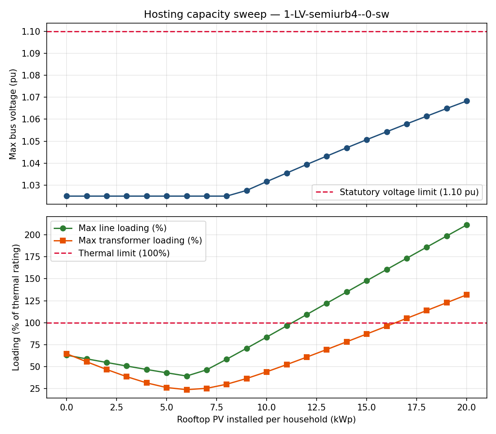
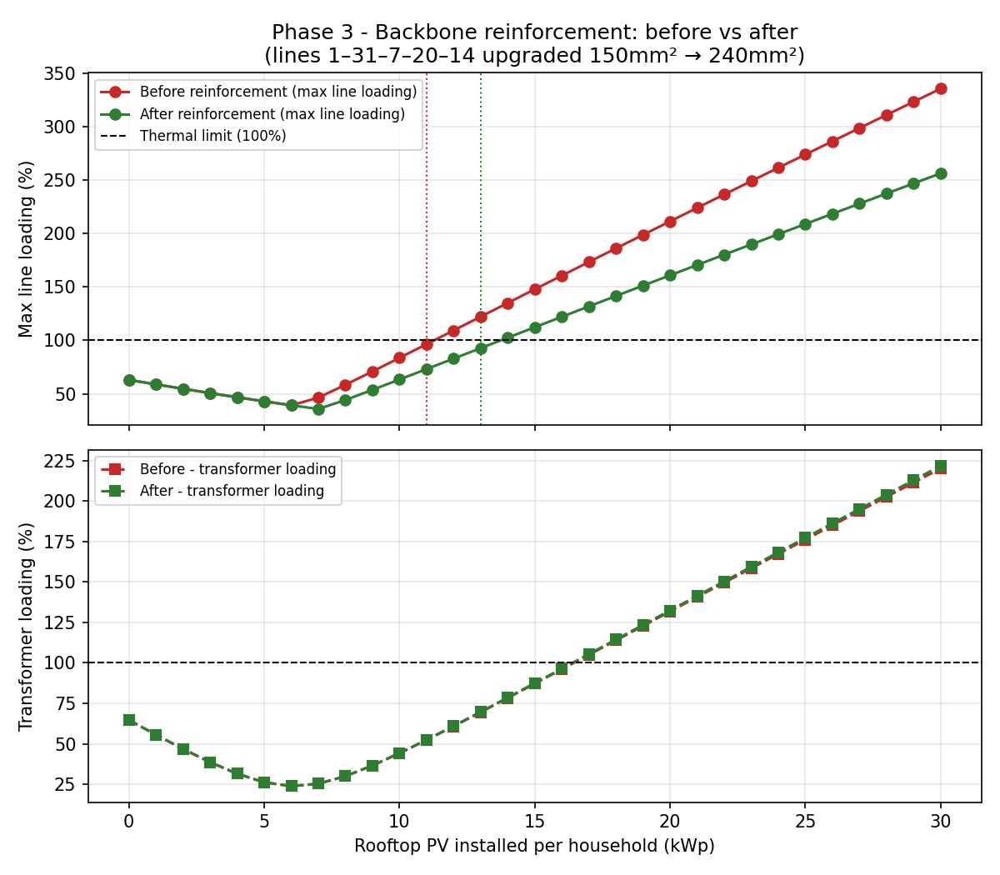
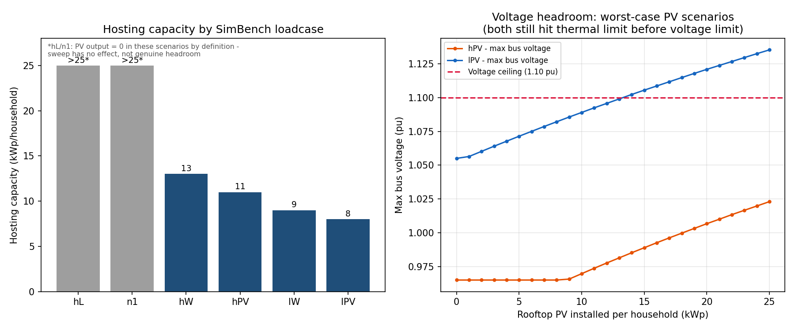
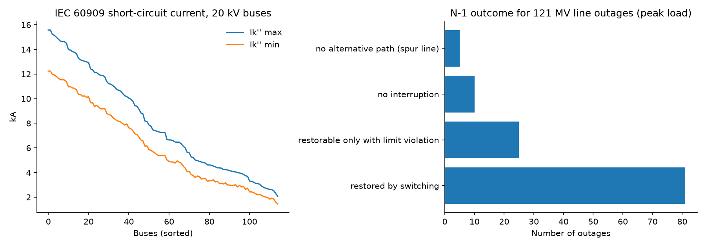

# LV Feeder Hosting Capacity Study — SimBench `1-LV-semiurb4--0-sw`

A power-flow-based study of how much rooftop solar PV a semi-urban German
low-voltage feeder can absorb before it violates voltage or thermal limits,
what a targeted reinforcement buys you, and why a single-snapshot answer
isn't the real answer. Built with [pandapower](https://www.pandapower.org)
and the [SimBench](https://www.simbench.net) benchmark network.

## Why I built it with open-source tools

As a student I had no access to commercial grid software such as
PowerFactory or PSS/E. So I set out to see how far the free tools get you
for the studies a DSO planner actually runs. The answer: hosting capacity,
reinforcement, load flow, short circuit to IEC 60909 and N-1 with
restoration switching are all doable with pandapower and the open SimBench
grids. Everything here runs on a laptop and every number can be reproduced
from the scripts.

## The question

"If every household on this feeder installed rooftop PV of size X kWp, at
what X does the feeder start violating its operating limits?" — the core
question a DSO answers before approving PV connection requests
(*Netzanschlussprüfung* / hosting capacity assessment).

## Network

- SimBench code `1-LV-semiurb4--0-sw`: low-voltage (0.4 kV), semi-urban,
  present-day scenario, with switchable tie topology.
- 44 buses, 42 lines (all `NAYY 4x150SE 0.6/1kV`, 150 mm²), 41 household
  loads, 1 transformer, 1 existing rooftop PV installation.

## Method, phase by phase

**Phase 1 — Baseline** (`phase1_baseline.py`). Load the network, run an AC
power flow (Newton-Raphson) at its default snapshot, confirm convergence,
and record the reference voltage/loading profile. Result: healthy baseline,
voltages 0.980–1.025 pu, busiest line at 63% loading, transformer at 65%.

**Phase 2 — Hosting capacity sweep** (`phase2_hosting_capacity.py`). Add a
rooftop PV generator to every household bus simultaneously, sweep the
per-household size from 0–20 kWp in 1 kWp steps, rerun the power flow at
each step, and find where a limit (1.10 pu voltage ceiling, 100% thermal
rating on any line or the transformer) is first crossed.
**Result: 11 kWp/household, limited by line thermal overload — not
voltage** — a four-line backbone trunk (bus chain 1→31→7→20→14) exceeds
100% loading before voltage gets anywhere near its ceiling.



**Phase 3 — Reinforcement** (`phase3_reinforcement.py`,
`phase3b_parallel_line.py`). Programmatically identify the overloaded
lines from Phase 2, then test two realistic, off-the-shelf reinforcement
options:
1. Upgrade the backbone from 150mm² to 240mm² cable (the largest LV cable
   in this network's standard type library) → capacity rises only to
   **13 kWp/household** (+18%).
2. Add a second parallel circuit alongside the upgraded backbone → capacity
   rises to **15 kWp/household**. The overload then moves to the next
   unreinforced section *further out* along the feeder (line 2→1, just
   beyond the reinforced trunk), and the 400 kVA transformer is already at
   97 % loading, so it would be the next limit right after.

**Finding: reinforcing one part of a radial trunk gives diminishing
returns.** The constraint moves to the next weakest element instead of
disappearing. The reinforced section already starts at the transformer, so
a real fix would mean extending the reinforcement further down the feeder
*and* planning a larger transformer (e.g. 630 kVA). I stopped here because
this cascade was the main point of the phase.



**Phase 4 — Multi-scenario sweep** (`phase4_multi_scenario.py`). Phases
1–3 all used one arbitrary default snapshot. Real studies test SimBench's
bounding loadcases instead, since the worst case for a thermal violation
(peak load) and the worst case for a voltage violation (minimum load +
peak generation + elevated upstream voltage) are different conditions:

| Loadcase | Description | Hosting capacity | Binding constraint |
|---|---|---|---|
| hL / n1 | Peak load, zero PV output | n/a (PV=0 by definition) | — |
| hW | Peak load + high wind (no wind gen on this feeder) | 13 kWp/household | thermal |
| hPV | Peak load + near-peak solar | 11 kWp/household | thermal |
| lW | Light load + wind | 9 kWp/household | thermal |
| **lPV** | **Light load + near-peak solar + elevated upstream voltage** | **8 kWp/household** | **thermal (3 % voltage rise equally tight, see 4b)** |

**lPV is the scenario that actually matters** — it's the standard
worst-case condition for hosting capacity studies, and it gives the lowest
(most conservative, most defensible) number. Against the absolute 1.10 pu
ceiling, thermal overload trips first (1.10 pu is only reached at 14 kWp).
But that is not the whole story for a German grid; see Phase 4b.



**Phase 4b — German 3 % voltage-rise rule** (`phase4b_vde4105_check.py`).
The 1.10 pu ceiling is not what a German DSO checks first. For PV in LV
grids, VDE-AR-N 4105 limits the voltage rise caused by generation to 3 %
at every connection point. I re-ran the lPV case, compared every LV bus
against the same case without the new PV, and took the worst bus:

| kWp/household | Max voltage rise | Max line loading |
|---|---|---|
| 8 | 2.96 % | 95.8 % |
| 9 | 3.31 % ❌ | 107.8 % ❌ |

So under the German rule **voltage and thermal limits bind at the same
point (8 kWp/household)**. The feeder is not just "thermally limited"; at
8 kWp it has almost no margin left on either side. Fixing only the cable
would immediately run into the voltage-rise limit, so measures like
reactive power control of the inverters (cos φ(P)) would have to be part of
the solution.

## Phase 5 - Medium-voltage grid study: load flow, short circuit, N-1

Script: `phase5_mv_loadflow_shortcircuit_n1.py` (runs in about 25 s).

Phases 1-4 looked at one LV feeder. Phase 5 moves up to the 20 kV level
and runs the three standard studies a DSO grid planner does, all with free
tools (pandapower + SimBench) instead of PowerFactory.

**Network:** SimBench `1-MV-semiurb--0-sw`, a German semi-urban 20 kV grid
(117 buses, 122 lines, 2 x 40 MVA 110/20 kV transformers) operated as open
rings with 8 normally-open tie switches, plus 121 generators (rooftop PV
aggregated from LV, MV wind, PV, biomass, hydro).

**5a Load flow in the bounding loadcases**

| Loadcase | Voltage band (pu) | Max line loading | Max trafo loading |
|---|---|---|---|
| hL (peak load) | 0.960 - 1.009 | 92.8 % | 42.3 % |
| hPV (peak load + PV) | 0.997 - 1.021 | 39.3 % | 18.3 % |
| lPV (light load + peak PV) | 1.014 - 1.050 | 56.9 % | 23.4 % |

The grid is within limits in normal operation. Peak load is the stressed
case (one line at 93 %); light load with peak PV pushes voltage up to
1.05 pu, still inside the band.

**5b Short circuit to IEC 60909 (3-phase)**

- Ik'' max 2.1 - 15.6 kA across the 20 kV buses, peak current ip up to 41.2 kA.
- Ik'' min 1.5 - 12.3 kA (used for protection pickup settings).
- Highest fault level is at the 20 kV busbar: 15.6 kA (about 540 MVA).
- Equipment check: this is fine for 20 kA switchgear (peak rating 50 kA).
  For 16 kA switchgear it is **not** fine: Ik'' leaves only ~2.5 % margin
  and ip = 41.2 kA exceeds its 40 kA peak withstand rating. In a real study
  I would ask the TSO/DSO for the actual 110 kV short-circuit power,
  because the result depends directly on that value.
- Assumption: the SimBench file has no 110 kV short-circuit data, so a
  typical infeed of 5000 / 3000 MVA (max / min), R/X 0.1 was set, and
  converter-based generation contributes 1.2 x rated current.

**5c True N-1 with restoration switching (peak load)**

Every one of the 121 in-service 20 kV lines was switched out one at a
time. When customers lost supply, the script tried each normally-open tie
switch and kept the first one that restores all load without breaking the
0.90-1.10 pu / 100 % limits (Wiederversorgung).

| Outcome | Outages |
|---|---|
| No interruption (meshed section) | 10 |
| Restored by closing one tie switch, no violations | 81 |
| Restorable, but only with a limit violation | 25 |
| No alternative path (spur line) | 5 |

**Finding:** the grid is N-1 secure for 91 of 121 outages at peak load.
The weak spots are the feeder head sections next to the substation
(lines 1-8): losing one of them moves a whole feeder onto its neighbour,
which then overloads (up to 164 %) and undervoltage appears (down to
0.835 pu). These are the candidates for reinforcement or an additional
tie, which is exactly the kind of recommendation a Netzplanung study ends
with.

Outputs: `phase5a_loadflow.csv`, `phase5b_short_circuit.csv`,
`phase5c_n1_contingency.csv`, `phase5_mv_summary.png`.



## Headline results

- **LV feeder:** the defensible hosting capacity is **8 kWp/household**
  (light load + peak PV), not the 11 kWp a single default snapshot
  suggests. At that point both the backbone cable (96 %) and the German
  3 % voltage-rise limit (2.96 %) are nearly used up.
- **Reinforcement:** upgrading one trunk section only moves the bottleneck
  further out; the transformer follows soon after.
- **MV grid:** N-1 secure for 91 of 121 line outages at peak load. The weak
  spots are the feeder head sections next to the substation, and the
  short-circuit level calls for 20 kA switchgear.

## Limitations (explicitly out of scope here)

- No reactive power control (cos φ(P)) or tap changer modelled yet, even
  though Phase 4b shows voltage rise is just as tight as cable loading.
- No N-1 contingency analysis on the LV feeder itself. (A true topology
  N-1 with restoration switching is now done at MV level in Phase 5.)
- No full 8760-hour time series — six representative SimBench loadcases
  were used instead of hourly profiles.
- No cost/economic comparison between reinforcement options.
- PV curtailment and other non-wire alternatives were not tested;
  reinforcement (bigger cable / parallel line) was the only lever.
- Reinforcement (Phase 3) and multi-scenario analysis (Phase 4) were run
  separately, not combined, to keep each result interpretable on its own.

## What I want to do next

- Add cos φ(P) reactive power control and a tap-changing transformer to
  the LV case and see how much hosting capacity that recovers compared
  with the cable upgrade.
- Run a full-year time series with the SimBench profiles instead of six
  snapshots.
- Bring the MV grid into PyPSA (it can import pandapower networks) to try
  optimisation-based reinforcement planning.

## Reproducing this

Requires `pandapower`, `simbench`, `pandas`, `matplotlib` (`pip3 install
pandapower simbench pandas matplotlib`). Run in order:

```bash
python3 phase1_baseline.py          # -> baseline_net.json
python3 phase2_hosting_capacity.py  # -> hosting_capacity_sweep.csv
python3 plot_hosting_capacity.py    # -> hosting_capacity_sweep.png
python3 phase3_reinforcement.py     # -> before/after reinforcement CSVs
python3 plot_phase3_comparison.py   # -> phase3_reinforcement_comparison.png
python3 phase3b_parallel_line.py    # -> hosting_capacity_sweep_phase3b_parallel.csv
python3 phase4_multi_scenario.py    # -> per-loadcase CSVs + phase4_scenario_summary.csv
python3 plot_phase4_summary.py      # -> phase4_scenario_summary.png
python3 phase4b_vde4105_check.py    # -> phase4b_vde4105_lPV.csv
python3 phase5_mv_loadflow_shortcircuit_n1.py  # -> phase5 CSVs + phase5_mv_summary.png
```
